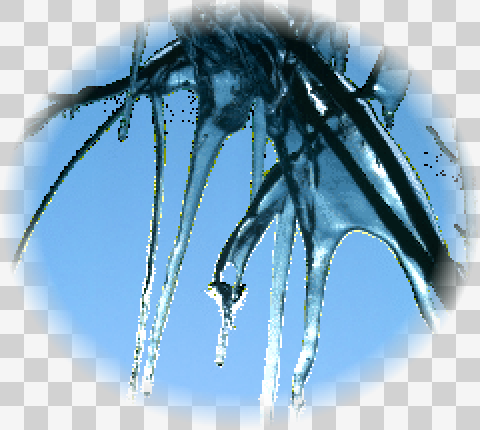
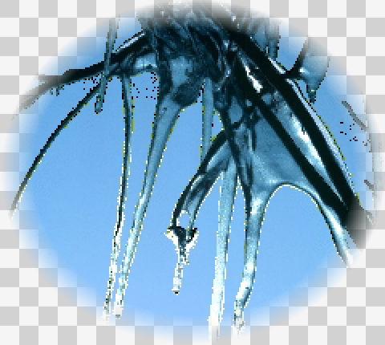
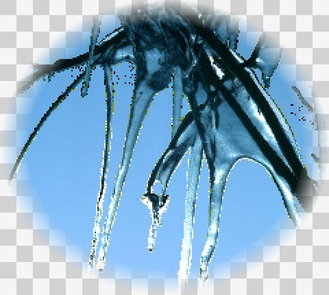

# HEIF and AVIF visual decoding example

These inputs reuse `TestAPI/sample.png` from this repository, adding a soft
circular alpha mask. The source RGBA PNG is encoded into HEIF/HEIC and AVIF
using libheif 1.23.2's `heif-enc -q 90` (with `-A` for AVIF).

The PNG previews below are created by **FreeImage_Load**, not by libheif's CLI
decoder. Both encoded files load as 240×215, 32-bit images through this PR's
plugins. `preview.cpp` composites the loaded pixels over a checkerboard and
exports a 2× PNG so GitHub and browsers can display the decoded result.

| Source PNG | HEIF loaded by FreeImage | AVIF loaded by FreeImage |
| --- | --- | --- |
|  |  |  |

Reproduce with the FreeImage build from this PR installed under `/tmp/fi`:

```sh
cmake -S Examples/heif-avif -B /tmp/fi-preview -DCMAKE_PREFIX_PATH=/tmp/fi
cmake --build /tmp/fi-preview
/tmp/fi-preview/HeifAvifPreview prepare TestAPI/sample.png Examples/heif-avif/source-rgba.png
heif-enc -q 90 Examples/heif-avif/source-rgba.png -o Examples/heif-avif/example.heic
heif-enc -q 90 -A Examples/heif-avif/source-rgba.png -o Examples/heif-avif/example.avif
/tmp/fi-preview/HeifAvifPreview decode Examples/heif-avif/source-rgba.png Examples/heif-avif/source-preview.png
/tmp/fi-preview/HeifAvifPreview decode Examples/heif-avif/example.heic Examples/heif-avif/heif-decoded.png
/tmp/fi-preview/HeifAvifPreview decode Examples/heif-avif/example.avif Examples/heif-avif/avif-decoded.png
```

Configure the FreeImage library with `-DBUILD_LIBHEIF=ON` before installing.
Encoding is performed by the external CLI; this PR adds decoding only.
